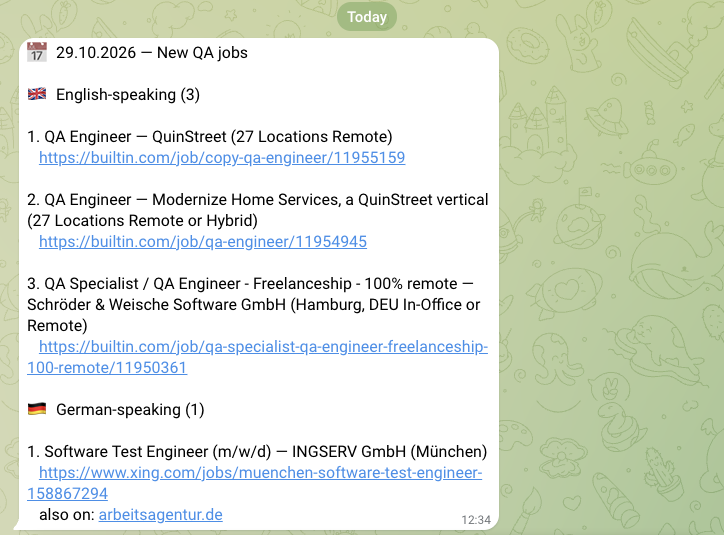

# job-search-agent

[](https://github.com/OleksandraZ/job-search-agent/actions/workflows/tests.yml)
[](https://github.com/OleksandraZ/job-search-agent/actions/workflows/daily-job-search.yml)

A pipeline that runs every morning on **GitHub Actions**. It collects new job
postings in Munich and remote roles across Germany from job boards and hundreds of
company career pages, keeps the ones matching your keywords, drops ones it has already
sent, sorts the rest by whether the role **requires German**, and posts the result to
Telegram. The role is just a YAML file: QA, Python, Cloud/DevOps and Data Engineering
sets are included, and [adding your own](#add-your-own-search) needs no code changes.



## Highlights

- **Sorting by required language, not the language of the ad.** A German ad that
  says "Deutschkenntnisse von Vorteil" is still fine for English speakers, and an
  English ad can still require C1 German. See [The language classifier](#the-language-classifier).
- **Many sources, one contract.** Every job board and ATS vendor (Greenhouse, Lever,
  Personio, Workday...) has its own adapter, and each converts its data into the
  same `NormalizedJob` shape, so the rest of the pipeline doesn't know where a job came from.
- **Each job is sent once.** The same posting on three boards, under a new tracking
  URL, or listed for another city is recognized and merged into one entry
  (`also on: …`), and isn't sent again for 90 days.
- **The company list maintains itself.** A weekly workflow re-checks every company's
  careers page and moves companies in or out of the fetch list when their ATS changes
  or their endpoint dies.
- **Every lesson is written down.** Real bugs and the reasoning behind each fix are in
  [`docs/lessons/`](#lessons-learned).

## How it's tested

260+ pytest tests run on every push ([`tests.yml`](.github/workflows/tests.yml)),
together with `ruff` and `mypy`. They're **fully offline**: HTTP calls are replaced
with stubbed responses shaped like the real payloads, so the suite runs in about a
second and never fails because a job board is down.

| Area | What the tests protect |
|---|---|
| Adapters (boards + ATS) | Each source's payload is mapped correctly into `NormalizedJob`; non-German locations are dropped; one failed request doesn't throw away the rest |
| Location + language classification | Munich/remote detection, German-requirement phrases, optional-language wording, negation |
| Filters | Whole-word title matching, excluded terms, required skills, maximum years of experience |
| Dedupe | Already-sent jobs stay out; reposts across boards/URLs are merged into one entry |
| Company resolution | ATS vendor detection and identifier extraction from careers pages; moves between the two company files |
| Infrastructure | Retry on 429/5xx, Telegram message splitting, config file validation |

Most classification and filter tests are **regression tests for bugs that reached a
real Telegram message**. For example, the title keyword `SDET` matched inside
"Emsdetten" (a German town) and sent a tax-clerk job as a QA role. Title matching
has used whole words since then, and a test pins that down
([`tests/test_filters.py`](tests/test_filters.py)).

## The language classifier

[`pipeline/classify_language.py`](pipeline/classify_language.py) uses rules, not an
LLM. The output feeds a daily decision about which jobs to apply for, so it needs to
be predictable, free to run and testable. Every rule in
[`config/language_rules.yaml`](config/language_rules.yaml) traces back to a real
posting it got wrong. It runs two checks:

1. **Explicit requirement.** Regexes for German-requirement phrases in both languages
   ("Deutsch C1", "verhandlungssichere Deutschkenntnisse", "fluent German"). A
   match doesn't count if optional wording ("von Vorteil", "nice to have", "a plus")
   follows **in the same clause**. Word gaps stop at `.`, `;` and HTML tags, so an
   optional phrase in one bullet point can't cancel a requirement in the next.
2. **Whole-description fallback.** If no phrase matches, it counts common German and
   English words. An ad written mostly in German (≥15 German words, ≥60% ratio)
   counts as German-required even if it never says so.

| Description | Result | Why |
|---|---|---|
| `Deutschkenntnisse B2 von Vorteil, aber nicht zwingend.` | English | German mentioned, but marked optional in the same clause |
| `Gute Deutschkenntnisse, Englisch von Vorteil.` | German | The optional wording applies to English, not German |
| `Deutschkenntnisse (B2). Andere Skills sind von Vorteil…` | German | "von Vorteil" is in the next sentence, so it doesn't apply |
| An ad written entirely in German with no language requirement stated | German | Fallback: 0.91–0.94 German word ratio on real samples vs 0.00 for an English ad |

## Lessons learned

[`docs/lessons/`](docs/lessons/) records about 40 real bugs and surprises found while
building this: what happened, how it was found and the rule that came out of it.

- [`classification.md`](docs/lessons/classification.md): the regex false positives
  behind the classifier, e.g. an optional phrase in one bullet point cancelling a
  real German requirement in the bullet next to it.
- [`adapters.md`](docs/lessons/adapters.md): building board adapters, e.g. a site
  whose `robots.txt` explicitly allows AI crawlers while its firewall blocks them
  anyway (treated as "don't scrape", not "work around it"), and search boxes that
  ignore the query.
- [`ats_adapters.md`](docs/lessons/ats_adapters.md): company career pages, e.g.
  Workday's search endpoint returning 400 above an undocumented page size of 20, and
  Greenhouse descriptions that are HTML-escaped twice.

## Use it for your own search

Fork it, point it at your own role, done. Searching for something other than QA
needs no code changes. Ships with four keyword sets as working examples: QA Engineer
roles (`config/keywords_qa.yaml`, the default), Python developer roles
(`config/keywords_python.yaml`), Cloud/DevOps roles (`config/keywords_cloud_devops.yaml`)
and Data Engineering roles (`config/keywords_data_engineering.yaml`) — see
[Add your own search](#add-your-own-search).

**Scope that's *not* yet configurable:** the location filter is fixed to Munich +
Germany-wide-remote (`pipeline/location.py`), and the board/company source lists
(`config/sources.yaml`, `config/companies.yaml`) are fixed and Germany-focused.
Only the keyword set (what roles you're matching) is swappable today — a fork
targeting a different city or country would need code changes, not just a new
config file.

See [`CLAUDE.md`](CLAUDE.md) for the adapter contract and contribution rules used
when extending this project with an AI coding agent.

## How it works

```
fetch (boards + companies) → scope filter (Munich / Germany-remote) → title match
  → optional filters (title excludes, required skills, description excludes,
    max years of experience) → dedupe (seen before?)
  → language classify (DE required / EN okay) → Telegram
```

- **Sources** — `config/sources.yaml` lists job boards; `config/companies.yaml` lists
  companies sourced directly from their ATS (Greenhouse, Lever, Personio, etc) —
  only ones that can actually be fetched; the rest wait in
  `config/unresolved_companies.yaml` with a `reason` and are re-checked weekly. Each
  source/company resolves to an adapter under `adapters/boards/` or `adapters/ats/`
  that fetches and normalizes postings into a common `NormalizedJob` shape.
- **Agents** — `agents/munich_local.py` and `agents/germany_remote.py` each filter the
  same raw job list down to their scope (`pipeline/location.py`).
- **Pipeline** — `pipeline/filters.py` matches titles against
  `config/keywords_qa.yaml` (or whatever file `--keywords` points at) and applies
  that file's optional filters (`pipeline/experience.py` reads the required years of
  experience from the description), `storage/dedupe.py` drops jobs already sent
  (SQLite, `storage/jobs.db`) — recognized by normalized title + company
  (`pipeline/duplicates.py`) or by the same source + URL, so a repost on another
  board, under a new tracking URL or for another city, or a listing retitled under
  its old URL, isn't sent again within 90 days — and
  `pipeline/classify_language.py` splits the rest into German-required vs
  English-okay. Copies of one job found in the same run become a single Telegram
  entry with an `also on: …` line.
- **Notifier** — `notifier/telegram.py` formats and sends the report.

## Setup

Requires Python 3.13+ (the same version the GitHub workflow uses).

```bash
python -m venv .venv
source .venv/bin/activate
pip install -r requirements.txt -r requirements-dev.txt
```

Create a `.env` file (git-ignored) with your Telegram bot credentials:

```
TELEGRAM_BOT_TOKEN=<your bot token>
TELEGRAM_CHAT_ID=<your chat id>
```

## Usage

```bash
# print the report instead of sending it to Telegram
python main.py --dry-run

# fetch, filter, and send today's report to Telegram (default: config/keywords_qa.yaml)
python main.py

# run against a different keyword set (e.g. the Python search)
python main.py --keywords keywords_python.yaml

# Excel report of ALL currently fitting jobs for all four searches (seen or not,
# duplicates across boards merged) - never sends or marks anything as seen.
# Writes reports/market_report_<date>.xlsx plus reports/raw_jobs_<date>.json
python -m tools.market_report

# rebuild the report in seconds from saved jobs after changing exclusions
# (new title_match_terms need a fresh fetch - they were never searched)
python -m tools.market_report --from-raw reports/raw_jobs_<date>.json
```

## Add your own search

Searching for a different role doesn't need any code changes — add a new YAML file
under `config/` and point `--keywords` at it:

1. Copy an existing file as a starting template, e.g.
   `cp config/keywords_qa.yaml config/keywords_frontend.yaml`.
2. Edit `title_match_terms`: the list of job-title words/phrases to match (case-
   insensitive, whole-word — a bare `Frontend` won't match inside an unrelated
   word). This list is also sent as the search query to every board that supports
   free-text search, so keep entries to plain role/skill terms, not full sentences.
   Include both English and German titles — German postings often keep the English
   title as a loanword, but not always.
3. Optionally add `title_exclude_terms`: drop any title match that also contains
   one of these words (e.g. `Senior`, `Werkstudent`) — useful when a broad term
   like a bare skill name would otherwise pull in postings outside your target
   seniority/employment type.
4. Optionally add `require_term_groups`: a list of groups; the title or
   description must mention at least one term from **every** group (e.g.
   `[[Python, SQL], [Airflow, dbt, Spark]]` = Python/SQL AND a pipeline tool). Jobs
   with an empty description are kept, since "unknown" isn't "doesn't mention it".
   Optionally add `software_signal` (`{titles: [...], terms: [...]}`) instead: only
   jobs whose title matches one of `titles` (ambiguous ones like `Quality Engineer`,
   `Testingenieur`) must mention one of `terms` — keeps manufacturing/hardware QA out
   without requiring a specific stack (used by `keywords_qa.yaml`).
5. Optionally add `description_exclude_terms`: drop a job whose title or
   description mentions any of these (domains like `Embedded`, `ISO 26262`). An
   entry can also be a conditional rule —
   `{terms: [Selenium, Cypress], unless: [Playwright, Python]}` only drops the job
   if none of the `unless` terms appear. Prefer `title_exclude_terms` for words that
   are often incidental in descriptions ("Vollzeit oder Teilzeit", perks lists).
6. Optionally add `max_required_years`: drop a job whose description asks for more
   years of experience than this (`pipeline/experience.py`); jobs stating no number
   are kept.
7. Optionally add `report_label`: names this search in the Telegram heading
   (`New {label} jobs`) and the no-jobs message, so different searches are
   distinguishable in chat history. Defaults to `"QA"` if omitted.
8. Run it: `python main.py --dry-run --keywords keywords_frontend.yaml` to check
   the output, then drop `--dry-run` once it looks right.

All four shipped `config/keywords_*.yaml` files document this contract in their own
`meta.usage` field with real worked examples (including one real trap: a
combinatorial multi-word phrase list matched zero real postings — short, bare
terms combined with `title_exclude_terms` worked far better in practice).

To run your new search on a schedule too, add a step to
`.github/workflows/daily-job-search.yml` next to the QA step (see
[Scheduled runs](#scheduled-runs-github-actions) below) — but check the runtime
first: every matched title costs one description request, so broad terms like
`Software Engineer` can turn a run from minutes into hours.

## Scheduled runs (GitHub Actions)

`.github/workflows/daily-job-search.yml` runs the QA keyword search once a day
(nominally ~06:13 Europe/Berlin - GitHub often starts scheduled runs hours late) and
on manual dispatch; the other keyword files are run locally on demand. It needs
two repo secrets (Settings → Secrets and variables → Actions):

```
TELEGRAM_BOT_TOKEN
TELEGRAM_CHAT_ID
```

`.github/workflows/weekly-company-recheck.yml` runs `python -m tools.resolve_ats`
every Sunday (2-3 hours, no secrets needed): it re-detects every
`config/unresolved_companies.yaml` entry, live-checks every `config/companies.yaml`
ATS endpoint, moves companies between the two files, and commits
`tools/resolve_ats_report.md` — counts per reason, what moved, and `CHECK:` cases
worth a manual look. It shares the daily run's concurrency group, so the two never
push at the same time.

`storage/jobs.db` (dedupe state) and `config/companies.yaml` /
`config/unresolved_companies.yaml` (ATS resolution results) are tracked in git rather
than ignored, because the runner's filesystem
doesn't survive between runs — the workflow commits whatever changed back to the
repo at the end of each run so the next scheduled run sees it.

That means the bot pushes a commit to `main` after every run. Always
`git pull --rebase` before pushing, and **never force-push** — a force push
silently replaces the bot's commits, the dedupe DB falls back to an old state, and
the next run re-sends every job seen since then as "new". The same applies after a
local run without `--dry-run`: it updates `storage/jobs.db` locally, so pull first
and commit the DB afterwards.

## Project layout

```
adapters/boards/   job-board adapters (fetch_jobs(source_config) -> list[NormalizedJob])
adapters/ats/      company-direct ATS adapters (fetch_jobs(company_config) -> list[NormalizedJob])
adapters/registry.py  adapter lookup + fetch_from_sources()/fetch_from_companies()
agents/            scope filters (Munich-local, Germany-remote)
pipeline/          title/skill/description/experience/location/language filtering
storage/           SQLite dedupe of already-sent jobs
notifier/          Telegram formatting + sending
config/            sources.yaml, companies.yaml, keywords_*.yaml, language_rules.yaml
tools/             resolve_ats.py — resolves companies to an ATS vendor (weekly re-check);
                   company_lists.py — keeps companies.yaml to fetchable companies;
                   market_report.py — Excel report of all fitting jobs
reports/           market reports + saved raw jobs (git-ignored)
docs/lessons/      the "why" behind adapter/classification gotchas
tests/             pytest suite (offline; run in CI by .github/workflows/tests.yml)
```
